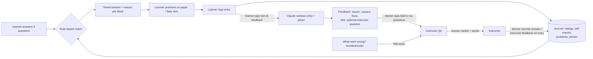

# InkLab: answers to the five questions (updated)

## 1. Working build, instructions, and an example

**Build:** https://claude.ai/artifact/8QxgSrk1d86xUghk5zaAQr. Anyone with the link can open it if they have a Claude account. The AI coach runs on each viewer's own Claude account with no API key, and each person's journal is private to them. Code: https://github.com/suchisundar/inklab. A Vercel version (`inklab.vercel.app`-style link, AI coach gated by a class code) can be deployed with the steps in the README.

**Gallery post (copy/paste):**

> **InkLab: a practice coach for beginner tattoo artists**
> Learning to tattoo on fake skin without someone next to you raises two questions over and over: *what should I practice next?* and *what am I doing wrong?* InkLab answers both.
>
> **Try it:** https://claude.ai/artifact/8QxgSrk1d86xUghk5zaAQr
> 1. **Practice tab:** pick your stage, what you want to improve, and how much time you have. You get a timed session (warm-up → main exercise → fix-it drill → log it), with a one-line reason for every block.
> 2. Do the exercise (paper or fake skin only), then **Log it**: how it felt, the self-check, any problems, and a photo.
> 3. **Journal:** tap *Get AI feedback* on an entry for what's working, up to 3 issues with cause + fix, and a drill.
> 3b. Practiced something on your own? **Journal → Upload practice photo**, say what it was, and get the same AI feedback.
> 4. Stuck? **What went wrong?** lists causes and fixes. *Still stuck* saves a question to **Instructor Qs**, which turns everything into one polite message for your instructor.
>
> **Example:** I said "practicing on fake skin, linework, 30 minutes", and I'd logged blowouts on straight pulls three sessions running. InkLab gave me: paper grip warm-up (5) → straight pulls (10, because the last attempts felt hard) → depth test as a fix-it drill for blowouts (10) → log it (5). Since blowouts came up 3 times, it also suggested asking my instructor about it.

## 2. Workflow, decision space, and human approval points

**Decision space: what the system decides vs. what the learner decides**

| Decision | Who decides | How |
| --- | --- | --- |
| Today's main exercise, drill, time split | Coach (rules in `js/coach.js`) | Repeat if last attempt was Hard or under 50% self-check → finish an exercise you've started → next unsolid exercise at your level, prerequisites first → a recurring problem (2+ in last 10 entries) always gets its drill. Every block shows its reason. |
| When an exercise counts as "solid" | Coach | 2 of last 3 attempts felt Okay/Easy **and** ≥75% of the self-check ticked |
| What went wrong in a photo (guided entries and free-practice uploads) | AI (Claude), advisory only | Max 3 issues, picks the drill from the app's own exercise list (schema-enforced), flags bad photos, must say when it's unsure |
| Stage, focus, time | Learner | The three questions. The coach trusts a stated level |
| Whether a session or entry is good | Learner | Difficulty rating and self-check ticks drive everything above |
| Anything about safety, hygiene, machine setup, real skin | Instructor | The AI is told to route these to `ask_instructor`, never answer them |

**Human approval points** (nothing leaves the learner's hands without a tap):
1. **Logging:** only the learner's own ratings and ticks update their progress. The AI never edits the journal.
2. **Sending to AI:** a photo and entry go to Claude only when the learner taps *Get AI feedback*.
3. **Instructor questions:** AI-suggested questions are saved only on *Add to my questions*, and editable before sending.
4. **Contacting the instructor:** the app never messages anyone. The learner copies the batch message and sends it themselves.
5. **Overriding the coach:** the learner can pick any exercise from the Roadmap. The plan is a suggestion.
6. **Destructive actions:** erase and import ask for confirmation in-page.

## 3. Evaluation results, improvements, and one challenge case

**What's measured.** `node eval/run.mjs` runs the practice coach on 25 learner scenarios (answers + journal history) and checks four things per scenario:
- the main exercise is one an instructor would accept (gold label)
- blocks add up to the time chosen, with none under 3 minutes
- a recurring problem gets a block for its drill
- nothing is above the learner's level

| Version | Scenarios | Checks passed | Fully correct | Held-out fully correct |
| --- | --- | --- | --- | --- |
| v1 baseline | 18 | 55/60 (92%) | 13/18 | - |
| v1 progression fix | 18 | 58/60 (97%) | 16/18 | - |
| v1 on the new 25-scenario set | 25 | 77/83 (93%) | 20/25 | **4/7** |
| **v2 (this update)** | 25 | **83/83 (100%)** | **25/25** | **7/7** |

**Improvements in this update.** I wrote 7 new scenarios (S19–S25) *before* changing any code. They exposed a bigger problem than the two known failures. Stencil transfer was tagged with every skill, so it won the main slot in 3 of the 7 new cases. Once, it even replaced straight pulls the learner was halfway through. Changes:
1. Stencil transfer is now a setup step that comes right before the first design, not a competitor in every focus area.
2. The coach finishes an exercise you've started before opening a new one.
3. A recurring problem gets 10 minutes of its drill even in a 30-minute session. In a 15-minute session the drill becomes the main exercise.

**Challenge case: S13, blowouts logged twice, only 15 minutes.** Two good rules collide: "finish what you started" (straight pulls) vs. "target the recurring problem" (depth test), with time for only one. Change 2 actually broke this case. It had only been passing by accident, because the old ordering happened to put the drill first. Rule 3 now picks the drill, on the theory that repeating a pull you keep blowing out reinforces the habit. An instructor could reasonably prefer one careful set of pulls at a shallower depth. This is a judgment call, not a bug, so it's flagged for instructor review.

**Honest caveat.** 100% means the rules agree with *my* labels. I wrote the labels, the held-out cases, and the fix. The real test is an instructor reviewing `eval/gold.json` and writing 10 new cases. The AI photo feedback hasn't been scored yet. There's a plan for it in `eval/README.md`: 20–30 instructor-labelled photos, scored for problem recall, precision, drill match, and honesty about bad photos.

## 4. Remaining risks, safeguards, and next steps

| Risk | Safeguard in place | Still open |
| --- | --- | --- |
| Learner skips hygiene training or practices on a person | Every page says fake skin/paper only. The first session for a beginner is setup and hygiene. The AI is told never to advise tattooing a person. | The app can't verify what someone practices on |
| AI misreads a photo (glare, blur, can't feel depth) and gives confident wrong advice | Max 3 issues, "this often means…" wording, `photo_quality_note`, drill restricted to the app's own list, "your instructor's eye wins" under every review | Photo feedback accuracy is **unmeasured** until the labelled photo set exists |
| Coach rules encode one person's opinion of good progression | Rules are short, readable, and show a reason on every block. The curriculum is plain data an instructor can edit. | Gold labels not yet instructor-reviewed |
| Self-reports are noisy (ratings, ticked boxes) | "Solid" needs 2 of the last 3 attempts, not one | A learner who over-ticks moves on too fast. Instructor feedback is stored but doesn't feed the rules yet. |
| Over-reliance: the app replaces an instructor instead of focusing questions for them | Safety, setup, and machine questions route to Instructor Qs. Repeated problems trigger "ask your instructor". | Nothing forces the loop to close |
| Privacy of photos and journals | Data stays in the learner's browser or private per-user storage. AI sees an entry only on request. Vercel key stays server-side, gated by `CLASS_CODE`. | Learners may not realise clearing browser data deletes the journal (Export exists) |
| API cost abuse on the Vercel build | Class code, one photo per request, spend limit advised | No per-user rate limit |

**Where I'd go from here:**
1. Get an instructor to review the gold labels and write new scenarios.
2. Build the photo-feedback gold set and score it.
3. Let instructor feedback count: an instructor's "not solid yet" should override the learner's self-check.

## 5. What I want to build next

**An instructor review loop.** A learner sends a read-only link to a few journal entries. The instructor marks each photo with the problems they see and the drill they'd assign, and can mark an exercise "solid" or "not yet".

Why this one, based on everything above:
- It closes the biggest gap in **evaluation**. Each instructor review is a labelled example, so the photo-feedback eval and the coach's gold set grow from normal use instead of extra work.
- It closes the biggest gap in **safety**. The person who can actually judge depth and hygiene becomes an approval point inside the app, not just a recipient of copied messages.
- It improves the **coach**. Instructor verdicts can replace noisy self-reports in the "solid" rule. Disagreements between the AI and the instructor become the next round of prompt fixes.

After that: side-by-side photo comparison of the same exercise over time, so learners (and instructors) can see progress rather than infer it from numbers.
